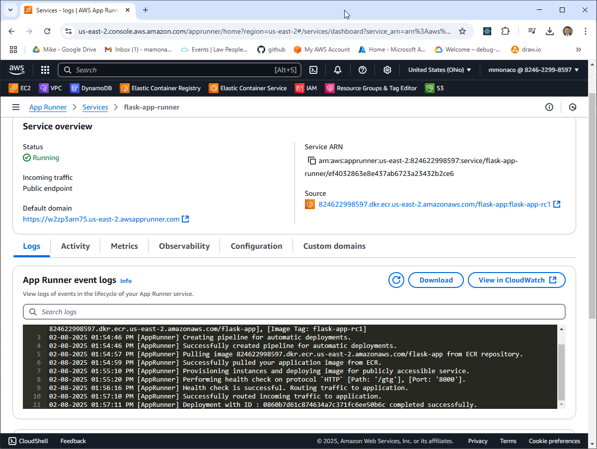
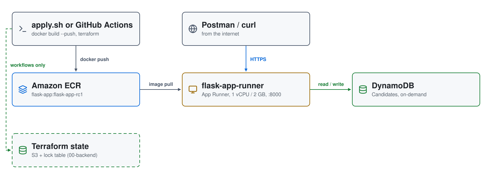
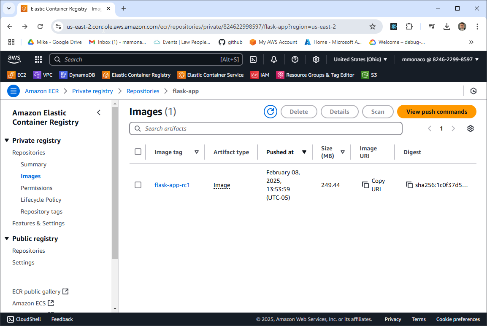

# Flask Microservice in a Container on AWS App Runner

Video 1 of the Simple Containers series. The same Flask candidate service
from the [AWS Auto Scaling](https://www.youtube.com/watch?v=aBMM6vjC8d0)
project, packaged as a **Docker** image, pushed to **Amazon ECR**, and run on
**AWS App Runner**, which handles the load balancing, TLS and scaling. The
service stores candidates in **DynamoDB**. GitHub Actions workflows can run
the same build.



| Piece | Where | Role |
|---|---|---|
| **Amazon ECR** | us-east-2 | `flask-app` repository; the image is tagged `flask-app-rc1` |
| **flask-app-runner** | App Runner | runs the image on port 8000 with 1 vCPU and 2 GB; health check `/gtg`; public HTTPS URL |
| **IAM roles** | global | `app-runner-build-role` pulls from ECR; `app-runner-run-role` allows DynamoDB `Query`, `PutItem`, `Scan` |
| **DynamoDB** | us-east-2 | `Candidates` table, keyed on `CandidateName` |
| **Terraform state** | S3 + DynamoDB lock table | only for the GitHub workflows, created by `00-backend/` |

## Architecture

<picture>
  <source media="(prefers-color-scheme: dark)" srcset="architecture-dark.svg">
  
</picture>

Regenerate with `python3 make_diagram.py`.

- **`00-backend/`**: the S3 state bucket and lock table for the workflows,
  plus the backend files it writes into `01-ecr/` and `03-apprunner/`.
- **`01-ecr/`**: the `flask-app` repository.
- **`02-docker/`**: the `Dockerfile` (Ubuntu 24.04, gunicorn on 8000), the
  app, and the `test_candidates.py` smoke test.
- **`03-apprunner/`**: the App Runner service, its roles, and the DynamoDB
  table.
- **`.github/workflows/`**: `checkenv`, `build`, `validate` and `destroy`
  workflows, run by hand; see
  [the workflow guide](.github/workflows/README.md).



## How it builds

1. Terraform creates the ECR repository.
2. `docker build --push` builds the image and pushes it as
   `flask-app:flask-app-rc1`.
3. Terraform creates the roles, the table and the App Runner service, which
   deploys that tag.

## API

| Method | Path | Returns |
|---|---|---|
| GET | `/gtg` | 200; with `?details=true`, connection and host details |
| GET | `/candidate/<name>` | the candidate, or 404 |
| POST | `/candidate/<name>` | `{"CandidateName": <name>}`, or 500 |
| GET | `/candidates` | every candidate, or 404 |

## Prerequisites

* [An AWS Account](https://aws.amazon.com/console/)
* [Install AWS CLI](https://docs.aws.amazon.com/cli/latest/userguide/getting-started-install.html)
* [Install Terraform](https://developer.hashicorp.com/terraform/install)
* [Install Docker](https://docs.docker.com/engine/install/)

If this is your first time watching our content, we recommend starting with
this video: [AWS + Terraform: Easy Setup](https://youtu.be/BCMQo0CB9wk).

## Deploy

```bash
git clone https://github.com/mamonaco1973/aws-flask-container.git
cd aws-flask-container
./apply.sh       # 1: ECR  2: docker build --push  3: App Runner + DynamoDB
```

Everything deploys to `us-east-2`, with local Terraform state. `apply.sh`
ends by running `validate.sh`, which runs the smoke test against the service
URL:

```
NOTE: Testing the App Runner Solution.
NOTE: URL for App Runner Solution is https://abc123xyz.us-east-2.awsapprunner.com/gtg?details=true
✓ good to go passed
✓ insert passed
✓ verification passed
✓ candidate list passed
```

To run it from GitHub instead, create your own repository from this template
and follow the [workflow guide](.github/workflows/README.md): it applies
`00-backend` once, then runs the workflows with your AWS credentials as
repository secrets.

## Try it

Call the endpoints at the App Runner URL with Postman or `curl`, for example
`curl https://<service-url>/candidates`.

## Teardown

```bash
./destroy.sh     # destroys the App Runner service and table, then deletes the ECR repository
```

## Notes

- **Lab only.** The service is public, with no authentication.
